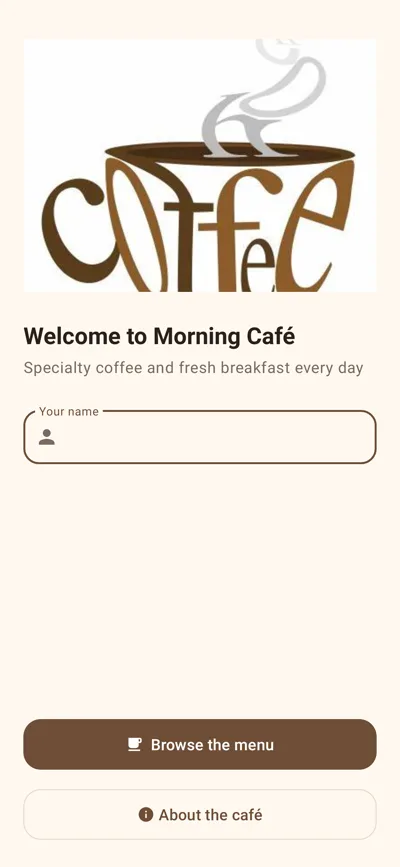
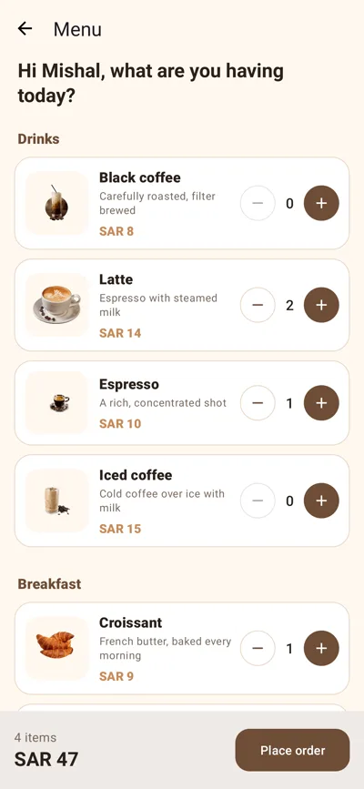
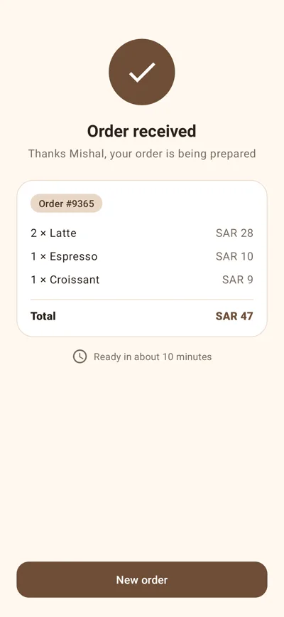
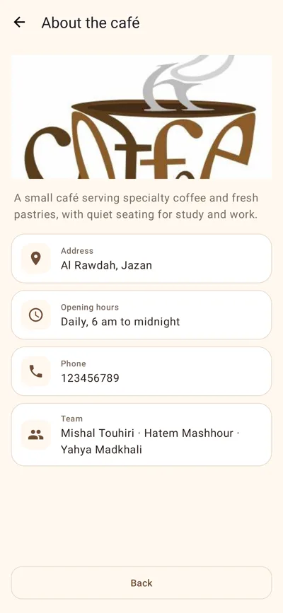
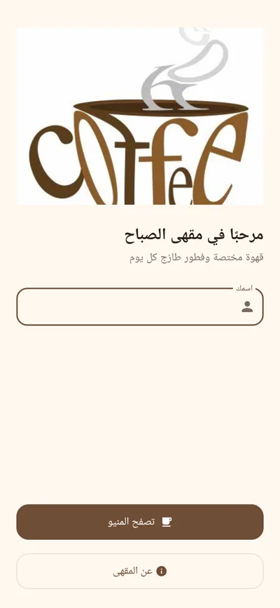
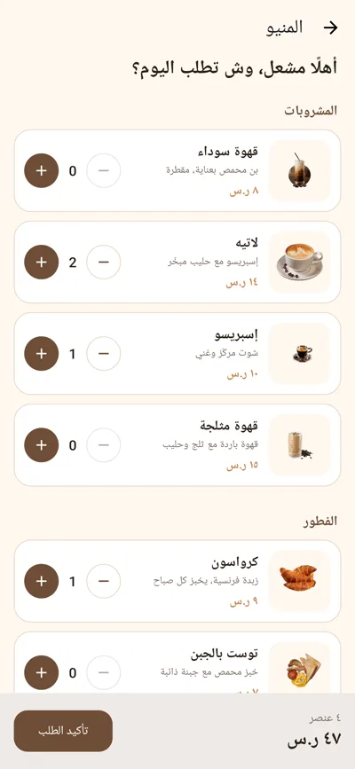
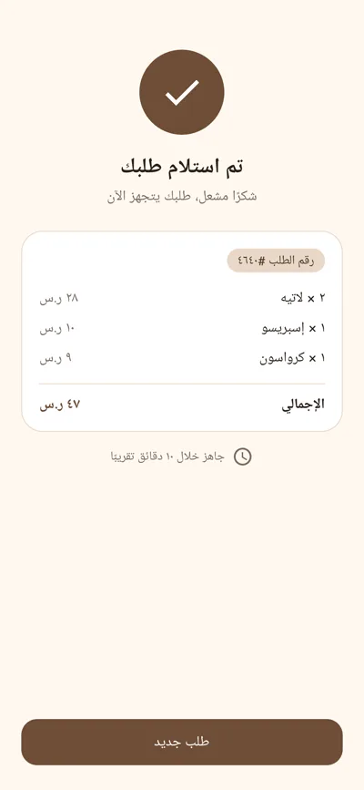
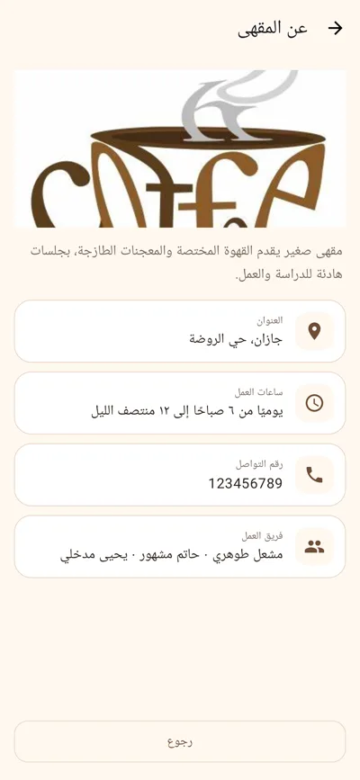

# ☕ Morning Café — مقهى الصباح

Android app for ordering from a small café menu, in Arabic and English.


| Welcome | Menu | Receipt | Café info |
|:---:|:---:|:---:|:---:|
|  |  |  |  |
|  |  |  |  |

<sub>Screenshots are generated from the real app by `CafeFlowTest` (see below).</sub>

## Features

- Welcome screen with the customer's name (validated inline)
- Menu in two sections (drinks, breakfast) with photos, descriptions and prices
- Quantity steppers per item, with a live item count and total at the bottom
- Order receipt screen with each line, the total and an order number
- Café info screen: address, hours, contact and the team
- Material 3 components and a coffee colour palette
- Arabic (right to left) by default, English on English devices

## Tech stack

| | |
|---|---|
| Language | Java |
| Platform | Android (compile/target SDK 34, min SDK 34) |
| UI | AppCompat, Material Components 1.11 (Material 3), ConstraintLayout |
| Tests | JUnit 4, Robolectric 4.13 |
| Build | Gradle (Kotlin DSL) |

## Run

Open the project in Android Studio and run the `app` configuration on a device or
emulator with Android 14 (API 34) or newer, or from a terminal:

```bash
./gradlew installDebug
```

## Tests and screenshots

`CafeFlowTest` (Robolectric) walks the whole flow: name check, quantities and
total, receipt and the info screen. It can also save a PNG of every screen:

```bash
./gradlew testDebugUnitTest -Pcafe.screenshots=build/screens
```

---

<div dir="rtl">

**مقهى الصباح** — تطبيق أندرويد لطلب القهوة والفطور من منيو مقهى صغير: إدخال الاسم، اختيار الكميات مع إجمالي مباشر، فاتورة الطلب، وصفحة معلومات المقهى. يدعم العربية والإنجليزية.

</div>
